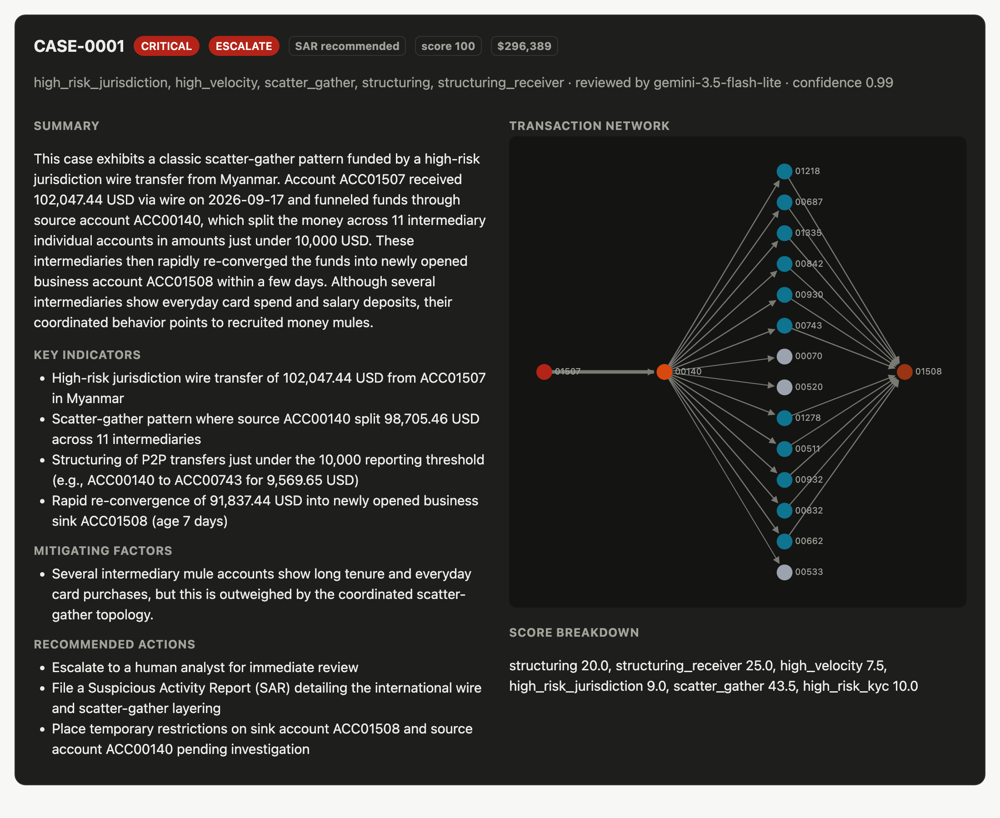

# Fraud & Anti-Money Laundering Detection Network

[](https://github.com/balamuruganvignesh/fraud-aml-detection/actions/workflows/tests.yml)

[](LICENSE)

A fraud/AML detection pipeline in **Python and SQL** that models transaction relationships as a
graph with **NetworkX** to surface money-laundering rings, and uses the **Gemini API** to flag and
summarize anomalous cases for analyst review.



**[View the full sample report →](https://htmlpreview.github.io/?https://github.com/balamuruganvignesh/fraud-aml-detection/blob/main/docs/sample_report.html)**
It was generated by `python -m aml run` with `gemini-3.5-flash-lite` on synthetic data: 1,518
accounts and ~30k transactions, with 12 planted laundering rings and 9 legitimate look-alikes.

```
 synthetic or CSV data
          │
          ▼
  ┌───────────────┐   SQL rules (sql/detection_rules.sql)
  │    SQLite     │── structuring · smurfing deposits · rapid pass-through
  │  aml.db       │   high velocity · high-risk jurisdictions
  └───────────────┘
          │
          ▼
  ┌───────────────┐   NetworkX graph detectors (aml/graph_analysis.py)
  │ MultiDiGraph  │── temporal cycles (round-tripping) · layering chains
  │ + DiGraph     │   fan-in collectors · scatter-gather / structured fan-out
  └───────────────┘   PageRank + Louvain communities for context
          │
          ▼
  case consolidation + risk scoring (aml/cases.py)
          │
          ▼
  Gemini triage: flag / risk level / summary / indicators / SAR call (aml/gemini_analyst.py)
          │
          ▼
  report.html · cases.json · metrics.json · cases tables in aml.db
```

## Quick start

```bash
python3 -m venv .venv && .venv/bin/pip install -r requirements.txt
cp .env.example .env          # add GEMINI_API_KEY (optional)
.venv/bin/python -m aml run   # then open output/report.html
```

Without a key, or with `--no-llm`, an offline rules-based reviewer produces the same review schema,
so the pipeline always runs end to end.

### CLI options

| Flag | Default | Meaning |
|---|---|---|
| `--accounts N` | 1500 | synthetic accounts |
| `--days N` | 30 | days of activity |
| `--rings N` | 3 | planted rings **per typology** |
| `--seed N` | 42 | RNG seed |
| `--accounts-csv / --transactions-csv` | – | run on your own data instead |
| `--no-llm` | off | skip Gemini |
| `--model` | `gemini-3.5-flash-lite` | Gemini model (or set `GEMINI_MODEL`) |
| `--max-llm-cases N` | 15 | cap on alerts sent to Gemini; the rest get the offline review |

Your own CSVs need `account_id` (accounts) and `txn_id, timestamp, sender, receiver, amount`
(transactions). `account_type, country, open_date, kyc_risk, channel` are optional.

## What it detects

**SQL rules** run inside SQLite with window functions and self-joins:

| Rule | Logic |
|---|---|
| `structuring` | ≥3 payments of $8k–$10k from one account inside 7 days |
| `structuring_receiver` | ≥3 distinct senders depositing $8k–$10k into one account inside 7 days |
| `rapid_pass_through` | money leaves within 48h of arriving, keeping 80–100% of the amount |
| `high_velocity` | ≥8 non-card outgoing transfers in 24h (known payroll originators excluded) |
| `high_risk_jurisdiction` | transfers ≥$5k to or from high-risk countries |

**Graph detectors** combine structure with *time*. A loop in the graph only counts if the money
actually travels around it in order:

| Detector | Logic |
|---|---|
| `cycle` | `nx.simple_cycles` on ≥$2k edges, then confirmed by a time-ordered traversal that finishes inside 21 days with ≥70% retained per hop |
| `layering_chain` | temporal DFS: ≥3 hops, each within 48h of the previous, keeping ≥85% of the amount; only maximal chains are kept |
| `fan_in` | sliding 72h window with ≥6 distinct senders and ≥$30k that the collector then **forwards** (≥60%) within 7 days; this separates mule collectors from merchants |
| `scatter_gather` | a source pays ≥6 receivers who mostly **re-converge** on one sink; this separates laundering from payroll |
| `fan_out` | the same split without re-convergence, but in mostly sub-threshold amounts |

Findings that share an account are merged into **cases** with union-find. High-degree hubs
(merchants, payroll employers, escrow agents) are not allowed to bridge cases. Each case is scored as
the weighted sum of its strongest hit per detector plus a KYC-risk bonus, capped at 100. Cases
scoring ≥40 become alerts.

## Gemini analyst review

Each alert's evidence goes to Gemini with **structured output**
(`response_schema` = a Pydantic `AnalystReview`). The evidence covers detector findings, account
profiles with PageRank percentile and community, aggregated graph edges, and a transaction sample.
The model returns:

`flag · risk_level · confidence · typology · summary · key_indicators · mitigating_factors ·
recommended_actions · sar_recommended`

The system prompt tells the model to weigh innocent explanations (escrow, payroll, family support),
so it can clear false alerts as well as escalate real ones. Rate limits and server errors are
retried with backoff. A bad key or bad model name falls straight back to the offline reviewer.

### Analyst work queues

Each reviewed alert is routed to a queue (`disposition` column in `cases`, `aml/models.py`):

| Queue | Rule | Meaning |
|---|---|---|
| `escalate` | flagged and HIGH/CRITICAL, **or** SAR recommended, **or** the case contains a `cycle` or `layering_chain` | investigate now |
| `review` | flagged, MEDIUM/LOW, no SAR | lower-priority analyst check |
| `close` | not flagged | close with the model's rationale, keep for trend monitoring |

**Policy floor:** round-tripping and layering have no everyday explanation, so cases containing them
always escalate, even if the LLM rates them lower or doesn't flag them. Overrides are recorded
(`policy_override` in `cases.json`, a "policy escalation" tag in the report, `+` in the CLI) so
analysts can see where the policy and the model disagreed. The set lives in `ALWAYS_ESCALATE` in
`aml/models.py`. Trade-off: legitimate chain- or loop-shaped activity that crosses the alert threshold
(an escrow home purchase, a quickly repaid loan) will also escalate. In the default data those
look-alikes score below 40 and never reach the queue.

With `gemini-3.5-flash-lite` on the default data, `escalate` holds all 12 real rings on every run.
Two of them get there only through the policy floor, overriding the model's MEDIUM rating. The
family-pooling false alert is **not stable across runs**. With the same evidence and prompt, one run
rated it MEDIUM with no SAR (→ `review`) and the next rated it HIGH with a SAR (→ `escalate`). The
model consistently lists its innocent explanations but weighs them differently from run to run.
`docs/sample_report.html` is the second, unflattering run.

**Free-tier keys:** calls are spaced 2s apart (`min_interval_s`). After two alerts in a row exhaust
their retries, the run stops calling Gemini (circuit breaker), so a used-up quota costs seconds rather
than minutes. The default model, `gemini-3.5-flash-lite`, has the most generous free-tier limits.
To use less quota, pass `--max-llm-cases 5`. Larger models (`--model gemini-3.8-flash`) give richer
reviews but run out of free quota quickly.

## Synthetic data and evaluation

`aml/data_generator.py` builds a realistic population: retail card spend at Zipf-popular merchants,
semi-monthly payroll, rent, peer-to-peer payments, B2B revenue, occasional large transfers and
family remittances. Into that it plants:

- **Laundering rings** (labelled): `cycle`, `fan_in` (smurfing), `scatter_gather`, `layering_chain`
- **Legitimate look-alikes** (labelled clean): home purchases through escrow (chain-shaped), families
  pooling a down payment (fan-in-shaped), and private loans repaid within weeks (2-cycles)

Default run (seed 42, 1,518 accounts, ~30k transactions):

| Metric | Value |
|---|---|
| Planted rings detected | 12 / 12 |
| Account precision / recall | 0.92 / 1.00 |
| Alert-case precision | 0.92 (one family-pooling look-alike reaches the alert queue) |
| Look-alikes kept below the alert threshold | 8 / 9 |
| Runtime (no LLM) | ~1–2 s |

The remaining false alert is the kind of case LLM triage is there to handle, and it shows the limits.
Gemini escalates all 12 real rings and names the look-alike's innocent explanations. Whether it
then clears the look-alike varies between runs (see *Analyst work queues*). An earlier prompt that
framed "ordinary-looking accounts" as exculpatory made the model clear two real round-tripping rings.
The prompt now weighs that context by typology, and a policy floor always escalates cycles and layering.

## Outputs

| File | Contents |
|---|---|
| `output/report.html` | KPIs, detection quality, alert queue, and case files with summary, indicators, an SVG network graph, accounts and transactions |
| `output/cases.json` | every case with findings, score breakdown and LLM review |
| `output/aml.db` | `accounts`, `transactions`, `rule_hits`, `cases`, `case_accounts`, `case_transactions` |
| `output/metrics.json` | precision/recall, ring detection by typology, LLM flag precision |
| `output/ground_truth.json` | planted rings and look-alikes |

Example queries:

```sql
-- alert queue with Gemini's verdict
SELECT case_id, risk_score, llm_risk_level, llm_flag, typologies FROM cases WHERE is_alert ORDER BY risk_score DESC;
-- every account in a case and its role
SELECT c.case_id, ca.account_id, ca.role, a.country, a.kyc_risk
FROM case_accounts ca JOIN cases c USING (case_id) JOIN accounts a USING (account_id);
```

## Tests

```bash
.venv/bin/python -m pytest -q
```

The detector tests use small hand-built graphs and include negative cases: scrambled-time cycles,
slow hops, merchants that keep their money, and payroll. The Gemini tests use a fake client to check
structured output, raw-JSON validation, retry and fallback, so they need no network.

## Layout

```
aml/
  config.py          thresholds, weights, LLM settings
  data_generator.py  synthetic population, rings and look-alikes
  database.py        SQLite schema/load and SQL rule runner
  graph_analysis.py  TransactionGraph + graph detectors
  cases.py           union-find consolidation, scoring, evidence
  gemini_analyst.py  Gemini structured review + offline fallback
  evaluation.py      metrics vs. ground truth
  report.py          SQLite/JSON persistence + HTML report
  pipeline.py        orchestration; __main__.py is the CLI
sql/schema.sql, sql/detection_rules.sql
tests/
```
